# Restic Studio

Restic Studio is a keyboard-driven terminal application for managing
[Autorestic](https://autorestic.vercel.app/) backup locations and the Restic
repositories they use. It gives you menus for starting backups, checking
repositories, inspecting snapshots, browsing snapshot contents, restoring data,
and managing repository keys.

Restic Studio is distributed as a **single application executable**. The
Autorestic configuration remains a separate YAML file, and the installed
`autorestic` and `restic` command-line programs do the actual backup and
repository work. Restic Studio does not bundle or reimplement those tools.

## Preview

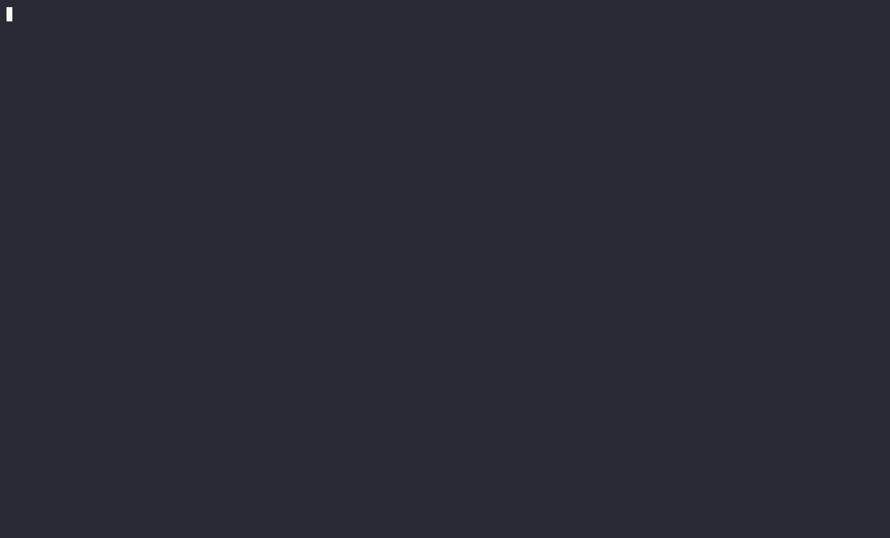

Watch the real application browse backup locations, review and cancel a backup,
check a repository, display statistics, list repository objects, browse snapshot
files, list keys, inspect available snapshots, and review and cancel a restore.
The extended recording pauses at each screen so you can follow the keyboard-driven
workflow. It uses only generated files in a disposable demo repository; no
personal backups or credentials are used, and no backup or restore is approved.

[Replay the original Asciinema recording](docs/recordings/walkthrough.cast)
locally with `asciinema play docs/recordings/walkthrough.cast`.

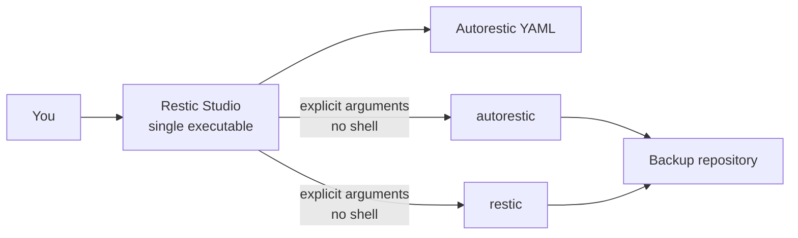

## Contents

- [Screenshots and recorded tests](#screenshots-and-recorded-tests)
- [Requirements](#requirements)
- [Install and run](#install-and-run)
- [Prepare your Autorestic configuration](#prepare-your-autorestic-configuration)
- [Navigate the application](#navigate-the-application)
- [Run a location backup](#run-a-location-backup)
- [Use repository tools](#use-repository-tools)
- [Credentials and security](#credentials-and-security)
- [Troubleshooting](#troubleshooting)
- [Build and test from source](#build-and-test-from-source)
- [Development and automation](DEVELOPMENT.md)

## Screenshots and recorded tests

These are real terminal captures of the compiled application, not mockups.
The walkthrough uses a disposable local Restic repository containing two
generated text files, a demo hostname, and a separate demo configuration.
No personal configuration, real credentials, or existing backup repositories
are used.

The capture runs the Go tests with race detection, builds the executable, and
drives the TUI with Expect while Asciinema records its terminal output.
[agg](https://github.com/asciinema/agg) renders the recordings into GIFs;
FFmpeg extracts PNG screenshots from selected frames.

### Dashboard

The dashboard shows the demo configuration and available locations and
repositories.

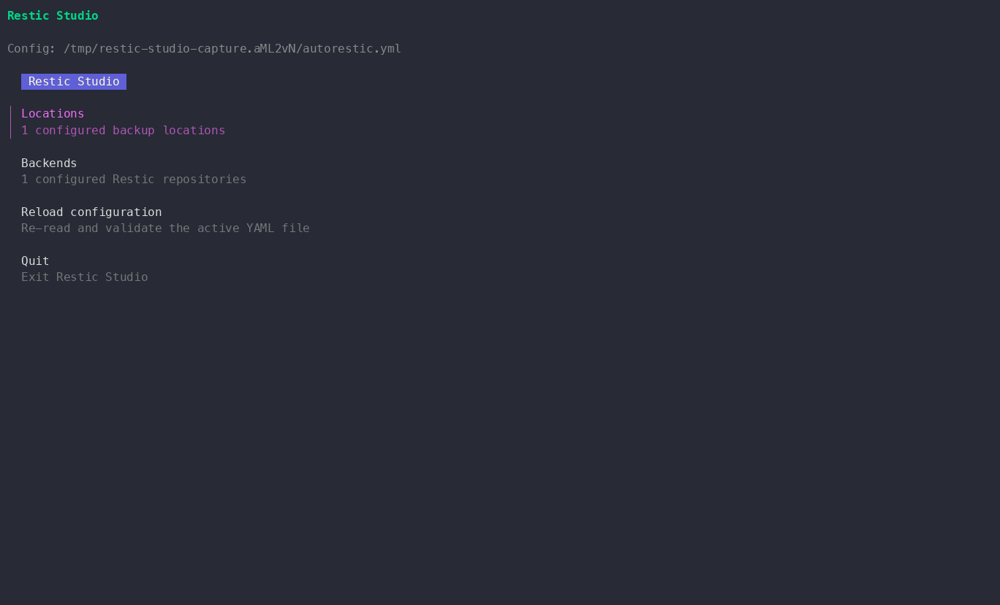

### Browse actual snapshots

Selecting **Backends → demo-local → Browse snapshots** runs Restic against the
temporary repository. The snapshot list displays a real snapshot of the
generated files, including its ID, hostname, timestamp, and source path.
Snapshot IDs, timestamps, temporary paths, and timings vary between captures.

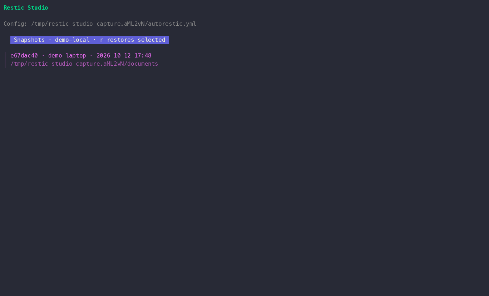

### Successful repository check

The **Check repository** operation completes with exit code `0` and Restic
reports that no errors were found.

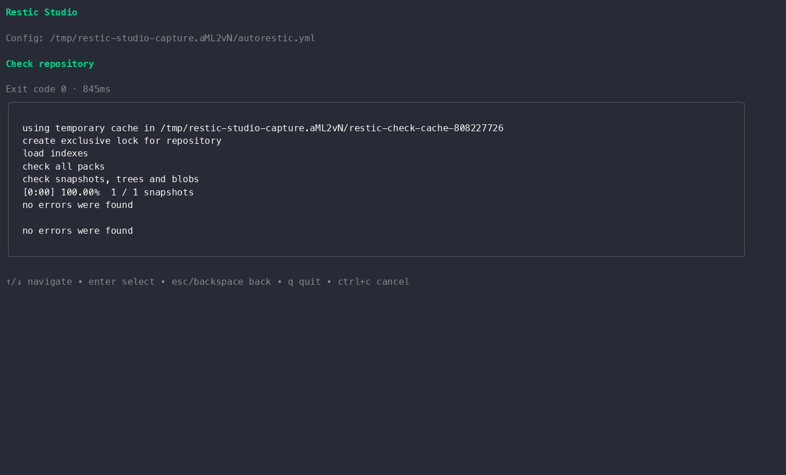

### Restore confirmation

Pressing `r` on the selected snapshot and entering `restore-preview` opens the
confirmation dialog. **The capture declines this operation with `n`: no
restore is performed.** The backup confirmation is likewise declined.

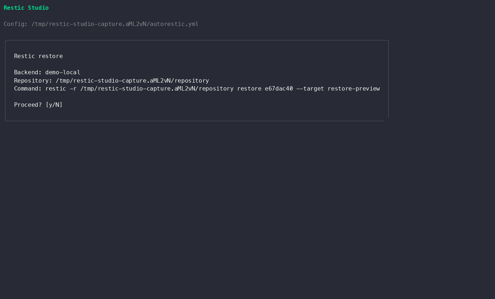

<details>
<summary>More screenshots: locations, backup confirmation, and repository tools</summary>

**Locations:** the generated documents location and its target repository.

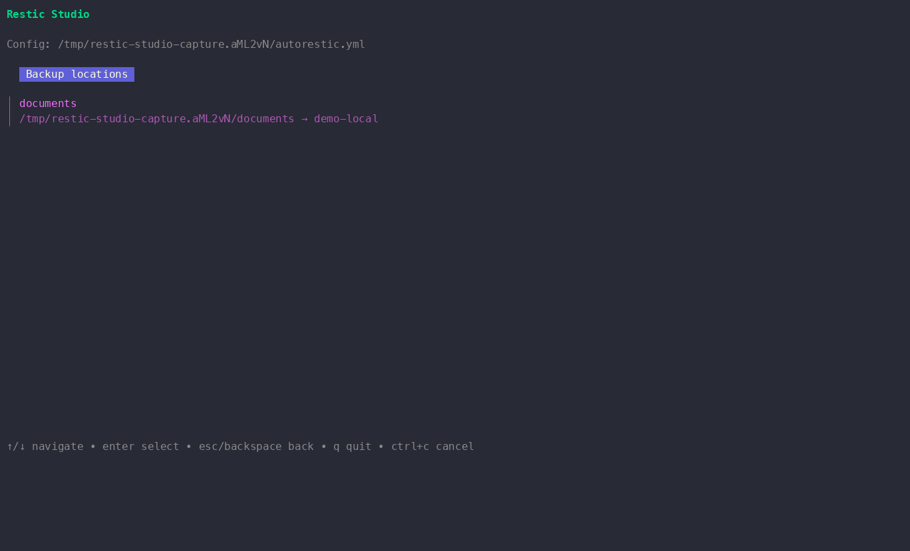

**Backup confirmation:** the command is reviewed, then declined without
starting Autorestic.

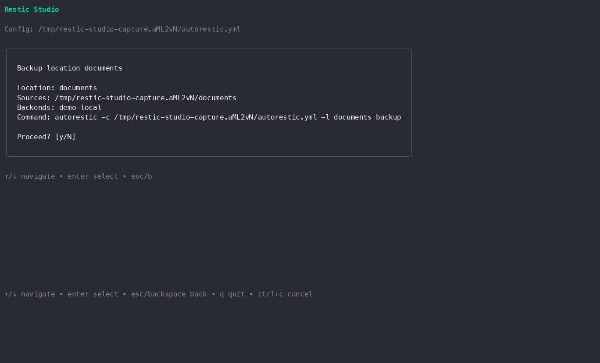

**Repository tools:** checks, snapshots, statistics, listing, restore, and key
management.

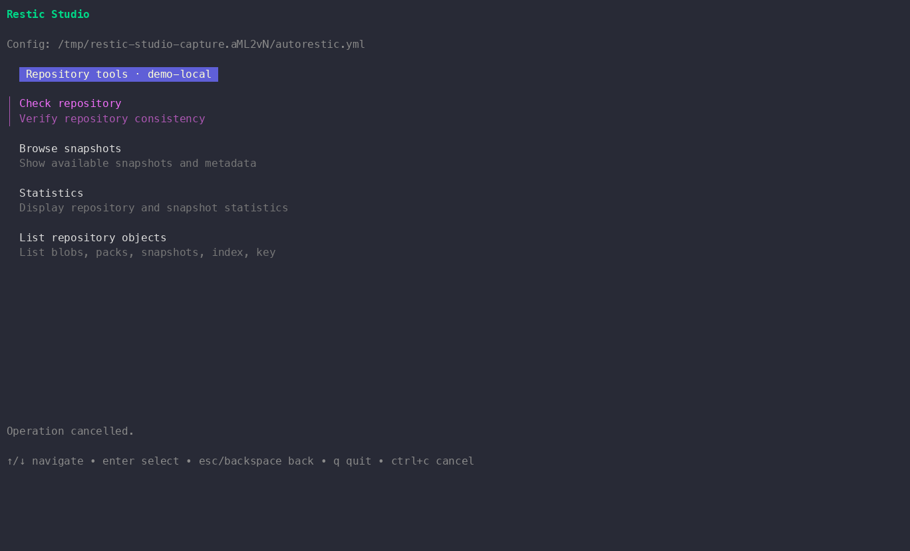

</details>

### Recorded Go tests

The captured test run executes `go test -race -count=1 ./...`. All packages
with tests pass; the CLI entry-point package reports `[no test files]`.
This is separate from the interactive walkthrough and does not require access
to a real backup repository.

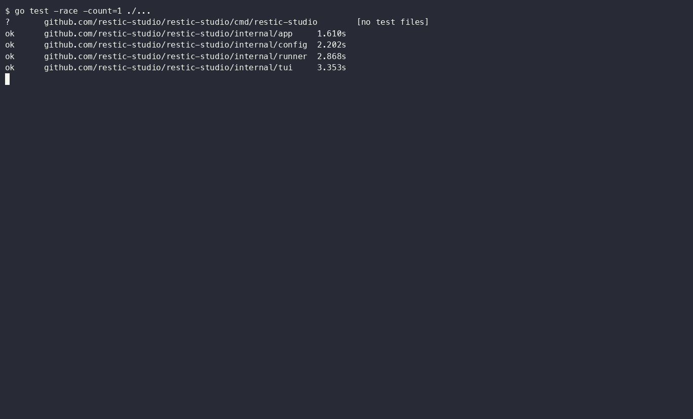

### Animated walkthrough and local replay

The extensive animation in [Preview](#preview) shows location and backend
navigation, backup confirmation cancellation, a successful repository check,
statistics, repository object listing, snapshot file browsing, read-only key
listing, snapshot selection, and restore confirmation cancellation.

The original recordings are included so you can replay the terminal output
locally with Asciinema:

```sh
asciinema play docs/recordings/walkthrough.cast
asciinema play docs/recordings/tests.cast
```

- [Application walkthrough recording](docs/recordings/walkthrough.cast)
- [Race-enabled test recording](docs/recordings/tests.cast)

These recordings are kept in the project; the capture script does not upload
them to a recording service.

### Regenerate the captures

On macOS or Linux, install Go, Restic, Autorestic, **Asciinema 3**, agg (with
`--select` support), FFmpeg, Expect, and Node.js, then run from the project
directory:

```sh
bash docs/capture.sh
```

The script creates a new temporary repository, initializes it, and backs up
only its generated demo files using Restic. It then records the tests and the
compiled application, asserts the expected TUI screens and check result,
renders the screenshots and animation, and removes the temporary repository,
config, password file, and executable. It overwrites only the capture assets
under `docs/images` and `docs/recordings`.

The walkthrough does not approve backups, restores, or key changes. It is a
visual smoke test, not proof that every operation or platform has been tested.
The replay files and screenshots are documentation assets, not a replacement
for the unit tests.

## Requirements

- **Go 1.24 or newer** to build Restic Studio from source. Go is not needed to
  run a binary after it has been built.
- The `restic` and `autorestic` executables installed and available on `PATH`.
  Restic Studio checks for both when it starts and shows a warning if either
  one is missing.
- An Autorestic v2-style YAML configuration. Restic Studio uses
  `~/.autorestic.yml` by default.
- A terminal that supports interactive keyboard input.

Before starting Restic Studio, you can check the dependencies from the same
terminal:

```sh
restic version
autorestic --help
```

Install [Restic](https://restic.readthedocs.io/en/stable/020_installation.html)
and [Autorestic](https://autorestic.vercel.app/) using their installation
instructions for your operating system. Restic Studio does not download,
install, or update them.

The application can be built for macOS, Linux, or Windows. You must build (or
obtain) an executable for the operating system and CPU architecture on which
you intend to run it. The corresponding Restic and Autorestic binaries must
also be installed on that machine.

## Install and run

### Build one executable

From the project directory, build an executable for the current machine:

```sh
go build -trimpath -ldflags="-s -w" -o restic-studio ./cmd/restic-studio
```

On macOS or Linux, make it available on your `PATH` if desired:

```sh
install -m 0755 restic-studio "$HOME/.local/bin/restic-studio"
```

Ensure `$HOME/.local/bin` is on your `PATH`. On Windows, copy
`restic-studio.exe` to a directory on `PATH`, or invoke it by its full path.
The application itself is a single executable; it does not need Go modules or
a Go installation at runtime.

> This build produces only Restic Studio. Install `restic` and `autorestic`
> separately; they remain required at runtime.

### Start with the default configuration

```sh
restic-studio
```

The default configuration path is:

```text
~/.autorestic.yml
```

Restic Studio resolves this to your home directory and displays the active
path on screen.

### Choose a configuration file

Use `--config` (or `-config`) to select another YAML file:

```sh
restic-studio --config /path/to/autorestic.yml
restic-studio -config ./autorestic.yml
```

For a project-local config, quote paths containing spaces:

```sh
restic-studio --config "$HOME/Backup Configs/personal.yml"
```

When running from source, the same option is available with:

```sh
go run ./cmd/restic-studio --config /path/to/autorestic.yml
```

The file is loaded and validated before the interactive screen opens. Use
**Reload configuration** on the dashboard to reread the same file after
editing it.

To start it from its current directory without adding it to `PATH`:

```sh
./restic-studio
./restic-studio --config "$HOME/Backup Configs/personal.yml"
```

In Windows PowerShell, the equivalent is:

```powershell
.\restic-studio.exe
.\restic-studio.exe --config "$HOME\Backup Configs\personal.yml"
```

### Startup flow

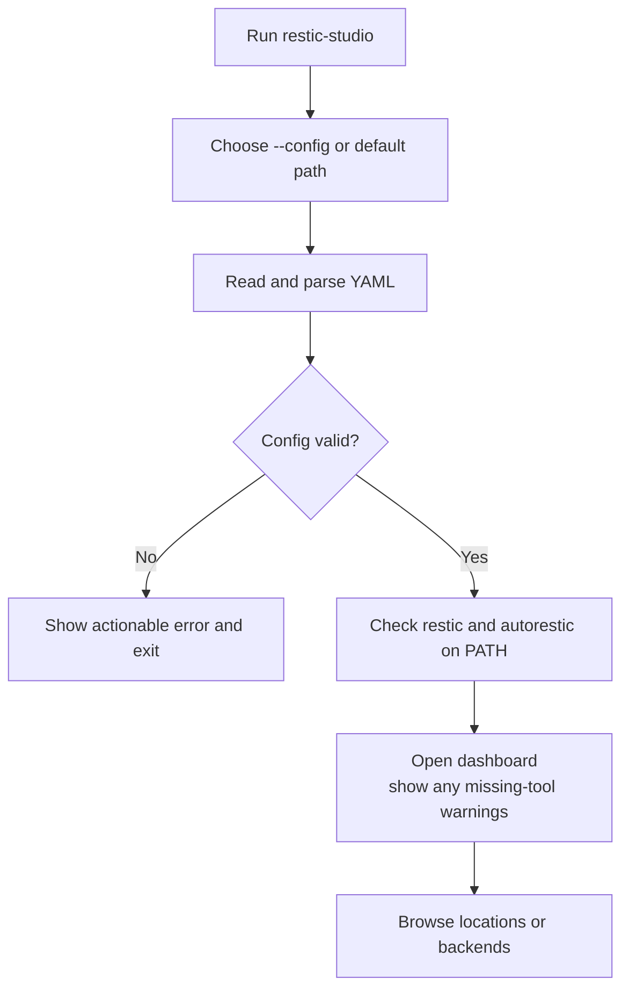

## Prepare your Autorestic configuration

Restic Studio relies on Autorestic to interpret and execute your backup
configuration. Keep using the Autorestic YAML format you already maintain; the
application reads the fields it needs to present locations, choose backends,
and provide credentials to child processes.

Here is a sanitized example:

```yaml
version: 2

locations:
  home:
    from:
      - ~/Documents
      - ~/Pictures
    to:
      - local-archive
    options:
      forget:
        keep-daily: 7
        keep-weekly: 4

  projects:
    from: ~/src
    to: [local-archive]

backends:
  local-archive:
    type: local
    path: /path/to/restic-repository
    key: REPLACE_WITH_A_REPOSITORY_PASSWORD
    env:
      EXAMPLE_STORAGE_TOKEN: REPLACE_WITH_A_REAL_TOKEN_IF_NEEDED
```

Replace the repository path and every credential placeholder before using the
example. Do not put real credentials in a file that is committed to a
repository or shared publicly.

The supported fields include:

| YAML field | Purpose |
| --- | --- |
| `version` | Autorestic configuration version. Use `2`; if present, any other version is rejected. |
| `locations` | Mapping of location names to backup location definitions. |
| `locations.<name>.from` | Required source path or list of source paths. A scalar, inline YAML list, or block list is accepted. |
| `locations.<name>.to` | Optional backend name or list of backend names. Each name must exist under `backends`. |
| `locations.<name>.options` | Optional location options retained in the configuration; Autorestic applies them when it runs a backup. |
| `backends` | Mapping of backend names to repository definitions. |
| `backends.<name>.type` | Optional backend type. For Restic repository commands, a non-local type is prefixed to a path unless the path already contains `:`. |
| `backends.<name>.path` | Required repository path or URL. |
| `backends.<name>.key` | Optional Restic password. It is supplied to Restic as `RESTIC_PASSWORD`. |
| `backends.<name>.env` | Optional map of environment variables passed to operations using this backend. |

For example, these are all valid `from` shapes:

```yaml
# Scalar
from: ~/src

# Inline list
from: [~/Documents, ~/Pictures]

# Block list
from:
  - ~/Documents
  - ~/Pictures
```

Use paths appropriate for the tool that consumes them. Autorestic interprets
location sources in the context of its own configuration. Restic Studio passes
backend repository paths directly to the `restic` executable without shell
tilde expansion; use an absolute filesystem path for local repository paths
(for example, `/Users/alex/backups/repo` rather than `~/backups/repo`).

Restic Studio validates required source paths, backend repository paths,
backend environment variable names, and location-to-backend references. It
does not edit the configuration or attempt to implement all YAML/Autorestic
features itself. Autorestic remains the authority for Autorestic-specific
options and backup behavior.

### How locations and backends relate

Locations describe **what to back up**. Backends describe **where the Restic
repository is**. A location's optional `to` list associates it with one or
more named backends.

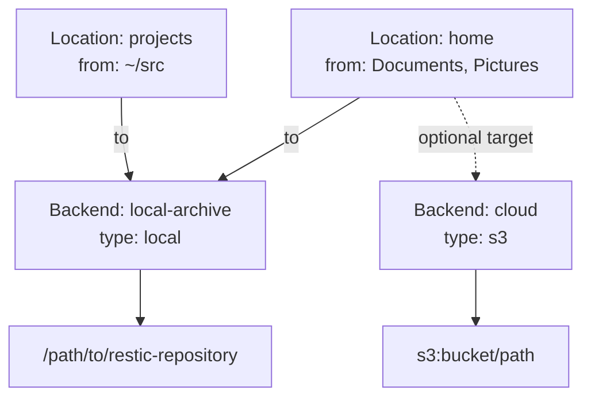

If a location omits `to`, its backup command still goes through Autorestic,
which reads the same config and determines its configured/default targets.
Restic Studio passes environment entries from all configured backends for
such a backup. If a location explicitly selects backends, it passes the
environment entries from those backends only. Conflicting configured values
for the same environment variable are reported by variable name, without
showing either value.

For example, to back up just `home` through Autorestic:

```text
Dashboard → Locations → home → review → y
```

To inspect a repository:

```text
Dashboard → Backends → local-archive → Browse snapshots
```

From the snapshot menu, Enter shows the selected snapshot metadata; `r` opens
the restore-destination prompt for that snapshot.

## Navigate the application

The dashboard displays the active configuration path, the number of
configured locations and backends, and any missing `restic` or `autorestic`
dependencies. Select a menu item with the arrow keys and Enter.

| Screen | What you can do |
| --- | --- |
| Dashboard | Open Locations or Backends, reload the active YAML file, or quit. |
| Locations | Review source paths and target backend names, then start a backup. |
| Backends | Select a configured repository and open its repository tools. |
| Repository tools | Check, browse snapshots, inspect statistics, list repository objects, browse snapshot files, restore, or manage keys. |
| Snapshots | Browse snapshot IDs, hostnames, timestamps, and paths; open metadata or start restoring a selected snapshot. |
| Confirmation | Review the operation, target, and command arguments before approving a write-like action. |
| Running operation | See the latest command output and request cancellation. |
| Command output | Review captured output, exit status, duration, and any error. |

### Keyboard controls

| Key | Action |
| --- | --- |
| Up / Down | Move through a menu. `j` / `k` may also navigate the list. |
| Enter | Select a menu item, inspect a snapshot, or submit a prompt. |
| Esc / Backspace | Go back. During a running command, Esc requests cancellation. |
| `y` | Approve a confirmation dialog. |
| `n` | Decline a confirmation dialog. |
| `r` | From the snapshot list, start a restore of the selected snapshot. |
| `q` | Quit from the dashboard or output screen. |
| Ctrl+C | Request cancellation while a command runs, or exit elsewhere. |

The active screen also displays keyboard hints. Prompts can be cancelled with
Esc. Password prompts mask typed characters.

## Run a location backup

1. From the dashboard, select **Locations** and press Enter.
2. Select a location. The list shows its source paths and configured backend
   targets (or indicates that Autorestic's default backends are used).
3. Review the confirmation screen.
4. Press `y` to start the backup, or `n`/Esc to cancel.
5. Watch live command output in the running screen. Press Esc or Ctrl+C to
   request cancellation.
6. When the process finishes, review its output and exit status; press Enter
   or Esc to return.

Conceptually, the command is invoked with explicit arguments equivalent to:

```sh
autorestic -c /absolute/path/to/autorestic.yml -l home backup
```

Restic Studio executes this directly rather than building a shell command
string. It does not currently offer a multi-location backup selector; start
each location's backup individually from the Locations screen.

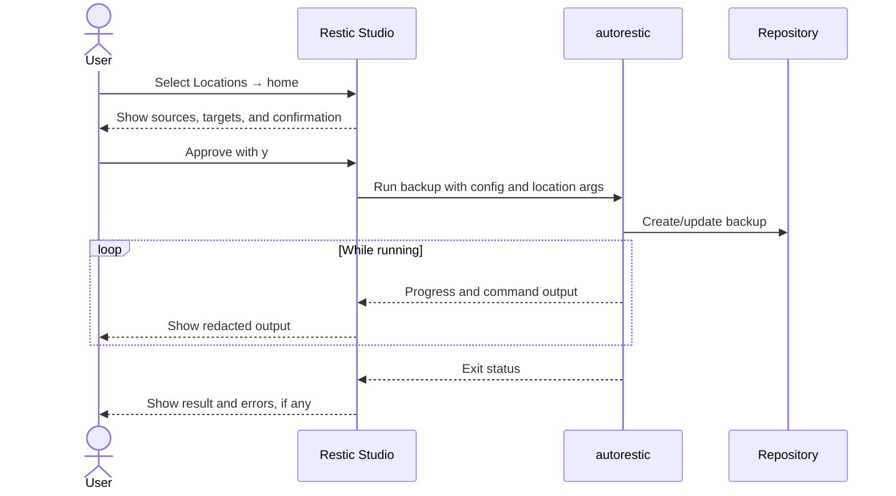

## Use repository tools

From the dashboard, open **Backends**, select a backend, then select a tool.
The selected backend's repository path is used for every Restic operation.
When `type` is set to a non-local type such as `s3`, and `path` does not
already contain a colon, Restic Studio constructs a repository value such as
`s3:bucket/path`.

| Tool | What it runs | Prompts / confirmation |
| --- | --- | --- |
| Check repository | `restic -r REPOSITORY check` | Runs immediately. |
| Browse snapshots | `restic -r REPOSITORY snapshots --json` | Shows snapshots as a selectable list with ID, host, time, and paths. |
| Statistics | `restic -r REPOSITORY stats` | Runs immediately. |
| List repository objects | `restic -r REPOSITORY list TYPE` | Prompts for `blobs`, `packs`, `snapshots`, `index`, `keys`, or `locks`; defaults to `snapshots`. |
| Browse snapshot files | `restic -r REPOSITORY ls SNAPSHOT [PATH]` | Prompts for snapshot ID (default `latest`) and an optional path. |
| Restore snapshot | `restic -r REPOSITORY restore SNAPSHOT --target DESTINATION` | Prompts for snapshot and destination; requires confirmation. |
| List repository keys | `restic -r REPOSITORY key list` | Runs immediately. |
| Add repository key | `restic -r REPOSITORY key add --new-password-file TEMPFILE` | Prompts for a masked new password; requires confirmation. |
| Change key password | `restic -r REPOSITORY key passwd --new-password-file TEMPFILE` | Prompts for a masked new password; requires confirmation. |
| Remove repository key | `restic -r REPOSITORY key remove KEY_ID` | Prompts for key ID; requires confirmation. |

When browsing snapshots, press Enter to display the selected snapshot's
metadata. Press `r` to restore that snapshot without retyping its ID, then
enter a destination and confirm. The restore destination is passed to Restic;
Restic determines the exact restored directory layout and any overwrite
behavior.

Key changes and restores modify repository state or local files. Check the
selected backend, repository, snapshot, key ID, and destination carefully
before approving.

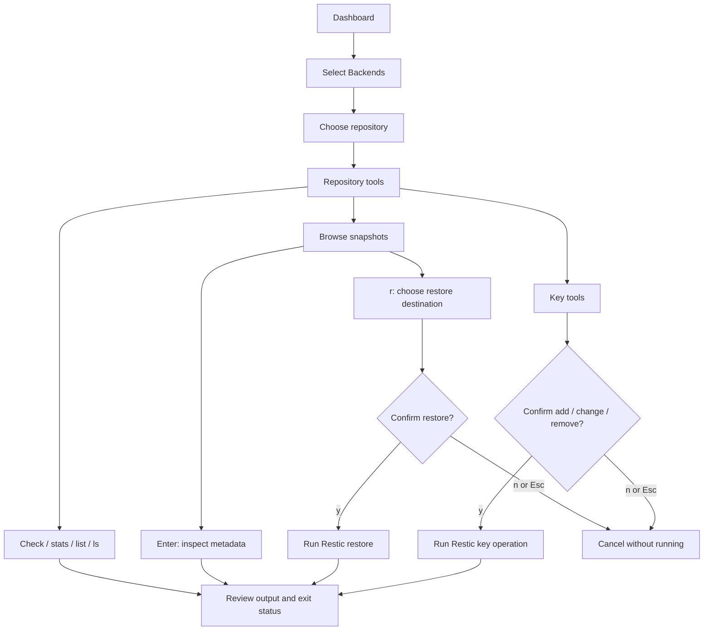

## Credentials and security

- Store the Autorestic YAML file with permissions appropriate to the
  credentials it contains. Restic Studio reads but does not update or encrypt
  that file.
- For Restic commands, the selected backend's `key` value is passed in the
  child process environment as `RESTIC_PASSWORD`. It is not put into the
  command-line arguments.
- Backend `env` values are merged with the inherited process environment for
  the relevant child process. Configured values override inherited values
  with the same variable name. For Autorestic backups, values are limited to
  the location's selected backend(s); when `to` is omitted, all configured
  backend environment values are included.
- Restic Studio redacts configured credential values from captured standard
  output and error output. It does not print configured secret values in its
  menus or confirmation text. Repository paths, location names, and source
  paths are not treated as secrets and may be displayed.
- New key passwords are entered with masked input and passed using a temporary
  password file with restrictive permissions. The file is removed after the
  operation, or if you decline the confirmation. If the application or
  computer is forcibly terminated during a key operation, check your system
  temporary directory for a leftover `restic-studio-password-*` file and
  remove it securely.
- Commands use explicit argument lists and do not invoke a shell. Long-running
  operations can be cancelled; Restic Studio does not silently retry them.
- A confirmation is not a substitute for a backup or a repository recovery
  plan. Verify destructive-operation details before approval.

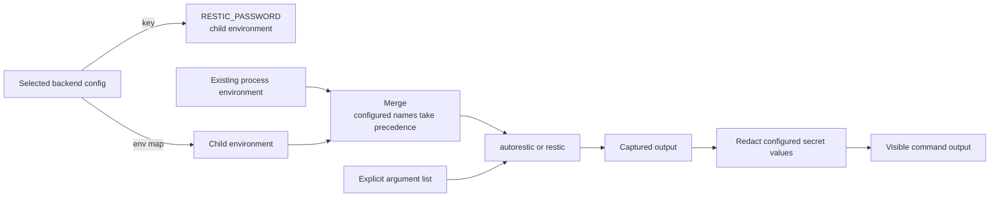

## Troubleshooting

### `restic` or `autorestic` was not found

Install the missing executable and ensure its containing directory is on
`PATH` in the environment from which you launch Restic Studio. Restart the
application after changing `PATH`. The dashboard reports each missing
dependency; an operation that needs a missing executable also shows an
operation error.

### The configuration file cannot be read

Check that the file exists, the path passed to `--config` is correct, and your
user can read it. Without `--config`, Restic Studio looks for
`~/.autorestic.yml`; it does not search the current directory for a config.

### YAML or validation error

Check indentation, quote values containing YAML-special characters, and make
sure each location has a non-empty `from` field. Every backend needs a
`path`, and each name in a location's `to` list must match a key under
`backends`. If present, `version` must be `2`. After saving corrections, use
**Reload configuration** to load the updated file.

### Authentication or repository error

Confirm the repository path and backend type, ensure the configured `key`
matches the repository, and verify that required storage variables are
present. Restic Studio shows command output and exit status; error wording
from Restic or the storage provider may identify the failing setting. Do not
post logs publicly until you have reviewed them for private paths or
information from the underlying tools.

### A backup fails or cannot access a source

Confirm that source paths exist and that the Autorestic command-line tool can
read the configuration and access those paths when run under the same user.
Check the selected location's `from`, `to`, and Autorestic `options`
settings. Restic Studio delegates backup behavior to Autorestic; it does not
rewrite Autorestic options.

### A command was cancelled

Esc or Ctrl+C requests process cancellation. The underlying command may need
time to stop and release a repository lock. Inspect the displayed result and
repository state before manually trying the operation again; Restic Studio
does not retry it.

## Build and test from source

With Make installed, `make test` runs tests, `make build` builds the executable,
and `make docs` generates a GitHub Pages-ready site in `_site`, with this README
as its home page and a separate [development guide](DEVELOPMENT.md) page.
`make api-docs` prints Go package documentation.

GitHub Actions tests each push and pull request before building Linux, macOS,
and Windows release archives for amd64 and arm64. Pushing a version tag such
as `v1.0.0` publishes those archives and checksums as a GitHub Release after
all tests, all binary builds, site generation, and the GitHub Pages deployment
from the same run succeed. Default-branch runs and version-tag pushes deploy
the site once GitHub Pages is configured to use **GitHub Actions** and the
`github-pages` environment permits the default branch and `v*` tags. A failed
deployment blocks release publication.
See the [development guide](DEVELOPMENT.md#github-actions-releases-and-pages)
for setup, artifact details, and local documentation generation.

```sh
go test ./...
go test -race ./...
go vet ./...
```

Build for the current machine:

```sh
go build -trimpath -ldflags="-s -w" -o restic-studio ./cmd/restic-studio
```

Cross-compile examples:

```sh
# Linux, 64-bit x86
GOOS=linux GOARCH=amd64 go build -trimpath -ldflags="-s -w" -o restic-studio-linux ./cmd/restic-studio

# Windows, 64-bit x86
GOOS=windows GOARCH=amd64 go build -trimpath -ldflags="-s -w" -o restic-studio.exe ./cmd/restic-studio

# macOS, Apple Silicon
GOOS=darwin GOARCH=arm64 go build -trimpath -ldflags="-s -w" -o restic-studio-macos-arm64 ./cmd/restic-studio
```

The `-s -w` linker flags strip symbol and debug information to reduce binary
size. Go's default build is suitable for local development; `-trimpath`
removes local source paths from the resulting executable.
